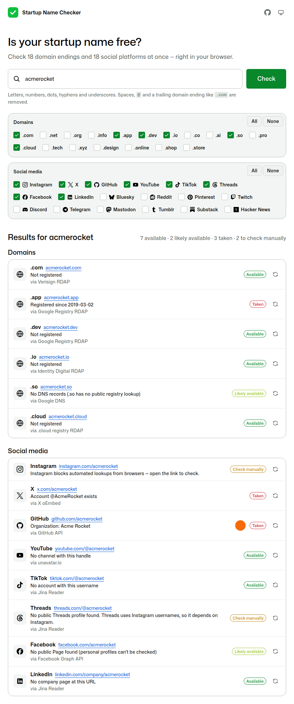

# Startup Name Checker

Check if a startup name is free as a **.com** and **.app** domain and on **Instagram, X, GitHub, YouTube, TikTok, Threads, Facebook and LinkedIn**, all at once.

**▶ Try it: <https://dariusz.porowski.dev/startup-name-checker/>**

It's one static page with no backend, no build step, no cookies and no tracking. Your browser does every lookup itself, against public endpoints that allow cross-origin requests. To share a result, add `?name=`, for example <https://dariusz.porowski.dev/startup-name-checker/?name=acmerocket>.



## What it checks

| Place | Link | How it's checked |
| --- | --- | --- |
| `.com` | `https://NAME.com` | [Verisign RDAP](https://rdap.verisign.com/), then [rdap.org](https://rdap.org/), then [Google Public DNS](https://developers.google.com/speed/public-dns/docs/doh/json) |
| `.app` | `https://NAME.app` | [Google Registry RDAP](https://pubapi.registry.google/), then rdap.org, then Google Public DNS |
| Instagram | `https://www.instagram.com/NAME` | Instagram blocks lookups from browsers, so open the link to check. Marked **taken** if the handle has a Threads profile. |
| X | `https://x.com/NAME` | X oEmbed, then [FxTwitter](https://github.com/FxEmbed/FxEmbed) |
| GitHub | `https://github.com/NAME` | [GitHub REST API](https://docs.github.com/rest/users/users#get-a-user) |
| YouTube | `https://www.youtube.com/@NAME` | [Unavatar](https://unavatar.io), then [Jina Reader](https://jina.ai/reader/) |
| TikTok | `https://www.tiktok.com/@NAME` | TikTok oEmbed, then Jina Reader |
| Threads | `https://www.threads.com/@NAME` | Jina Reader |
| Facebook | `https://www.facebook.com/NAME` | Facebook Graph API (public Pages only) |
| LinkedIn | `https://www.linkedin.com/company/NAME` | Jina Reader, then [Microlink](https://microlink.io) |

Each result has one of these statuses:

- **Available**: the service confirmed nobody uses the name.
- **Likely available**: no trace found, but the service can't fully confirm it.
- **Taken**: the name is in use.
- **Check manually**: the service blocks automated lookups, so open the link.
- **Unknown**: the lookup failed or hit a rate limit. Try again later.
- **Not allowed**: the name breaks the platform's username rules, for example X handles of more than 15 characters.

## Good to know

- YouTube and TikTok profiles live at `/@NAME`. Without the `@`, those URLs don't point to a profile. `threads.net` now redirects to `threads.com`.
- Threads uses Instagram usernames, so a Threads profile means the Instagram handle is taken. If there's no Threads profile, Instagram still needs a manual check.
- Facebook only exposes public **Pages**. Personal profiles are private, so "no Page found" is shown as **Likely available**.
- The free services limit how often each IP can use them: GitHub API 60 lookups/hour, Unavatar 25/day, Jina Reader 20/minute, Microlink 5/day. When a limit is hit, that row shows **Unknown**.
- Platforms change their pages without notice, so results are best effort. Confirm before you buy a domain or print business cards.

## Privacy

The name you type is sent directly from your browser to the services above, and nowhere else. The page sets a strict Content Security Policy that only allows connections to those hosts. It doesn't send cookies or a referrer, and it doesn't store anything.

## Development

Requires Node.js 20 or later. The app lives in [`site/`](site) and runs without a build step.

```sh
npm install
npm start                         # serves site/ at http://127.0.0.1:4173/
npm run test:unit                 # lookup logic with a mocked network (node:test)
npx playwright install chromium
npm run test:e2e                  # UI tests in Chromium with a mocked network
LIVE_URL=https://dariusz.porowski.dev/startup-name-checker/ npm run test:live   # real services
```

| File | Purpose |
| --- | --- |
| [`site/index.html`](site/index.html) | Page markup and Content Security Policy |
| [`site/checker.js`](site/checker.js) | Name rules and per-platform lookups (no DOM, testable in Node) |
| [`site/app.js`](site/app.js) | UI: renders rows and updates them as results arrive |
| [`site/icons.js`](site/icons.js), [`site/style.css`](site/style.css) | Icons and styles |
| [`tests/`](tests) | Unit tests, mocked UI tests and live smoke tests |

To add or change a platform, edit the `PLATFORMS` list in `site/checker.js`. If it uses a new host, add that host to `connect-src` in `site/index.html`; a unit test fails when one is missing.

## Deployment

Every push to `main` runs the [CI workflow](.github/workflows/ci.yml). It runs the tests, publishes `site/` to the `gh-pages` branch and waits for GitHub Pages to build it. Then it runs the [Live check workflow](.github/workflows/live-check.yml), which tests the deployed page against the real services. You can also run the live check manually from the Actions tab.

GitHub Pages is set to **Deploy from a branch**, using `gh-pages` and the `/ (root)` folder. In a fork, choose that setting after the first CI run has created the branch.

## Credits

- Brand icons from [Simple Icons](https://simpleicons.org) (CC0). Brand names and logos belong to their owners. This project isn't affiliated with any of them.
- [Avatars provided by Unavatar](https://unavatar.io).

## License

[MIT](LICENSE)
